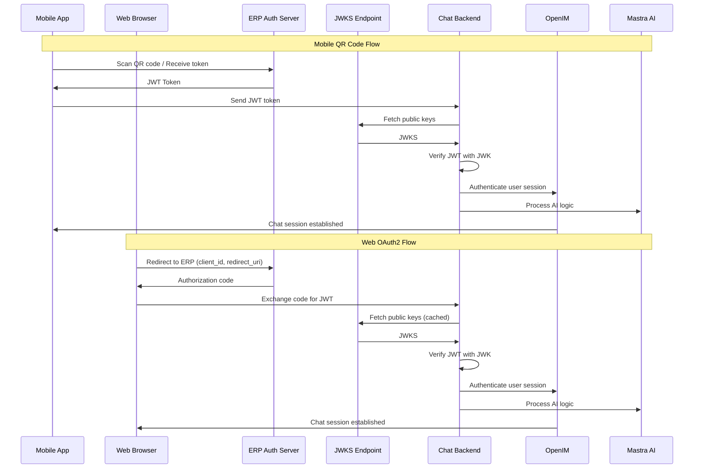

# [ADR-0002] Интеграция авторизации чат-сервиса с ERP через JWT и JWK

* **Status:** Proposed
* **Date:** 2025-11-07
* **Tags:** #auth #jwt #jwk #erp #openid-connect

## Контекст

Сервис чата (на базе Mastra и OpenIM) является отдельным от ERP-системы, которая выдаёт JWT-токены для аутентификации пользователей. Необходима безопасная авторизация:
- Для десктопа: через redirect в ERP и обратно (OAuth2-like flow).
- Для мобильного: через сканирование QR-кода, сгенерированного в ERP с авторизованным пользователем.

JWK (JSON Web Key) используется для верификации публичных ключей ERP в чат-сервисе, чтобы избежать передачи приватных ключей. Это обеспечивает децентрализованную верификацию JWT без доверия к третьим сторонам.

Текущий стек: OpenIM как IM-сервер для обработки чат-сессий, Mastra для ai-логики. Проект не имеет встроенной интеграции с внешними провайдерами аутентификации.

## Варианты решения

### Вариант 1: Интеграция с JWT и JWK через OAuth2/OpenID Connect

Реализовать авторизацию на основе OpenID Connect / OAuth2 с использованием JWT от ERP:
1. **JWK-интеграция**: Чат-сервис будет запрашивать JWKS с эндпоинта ERP (например, `/.well-known/jwks.json`) и кэшировать его для верификации JWT. Библиотека: `jose` (для Node/Go) или аналогичная.
2. **Десктопный flow**:
   - Redirect на ERP с `client_id`, `redirect_uri`, `response_type=code`.
   - Обмен code на JWT через `/token` эндпоинт ERP.
   - Верификация JWT в чат-backend с JWK; хранение сессии в cookies/localStorage.
3. **Мобильный flow**:
   - ERP генерирует QR с short-lived токеном (или deep link: `chat://auth?token=...`).
   - Мобильное app сканирует QR, отправляет токен на чат-backend.
   - Backend обменивает на полный JWT, верифицирует с JWK, выдаёт сессию.
4. **Интеграция с OpenIM/Mastra**:
   - Middleware в OpenIM для проверки JWT на входе в чат (WebSocket/API).
   - Mastra-клиент: обработка redirect/QR в UI (библиотека qrcode для генерации/сканирования).
5. **Безопасность**: Все запросы по HTTPS; ротация ключей через `kid` в JWK; аудитория (`aud`) в JWT только для чата; TTL токенов < 1h.

* **Плюсы:**
  - Безопасная децентрализованная верификация без хранения секретов в чате.
  - Поддержка SSO: пользователи авторизуются один раз в ERP.
  - Легко расширяемо на другие клиенты (web/mobile/desktop).
  - OpenIM интегрируется seamlessly через JWT-validation hooks.
  - Решение масштабируемо и соответствует стандартам (RFC 7519, RFC 7517).
* **Минусы:**
  - Зависимость от доступности JWKS-эндпоинта ERP (нужен fallback с кэшем).
  - Дополнительная сложность в мобильном app (QR-сканирование: ~100-200 строк кода).
  - Потенциальные задержки при первом fetch JWKS (решается prefetch).

### Вариант 2: Статический публичный ключ

Использовать статический публичный ключ для верификации JWT от ERP без использования JWKS.

* **Плюсы:**
  - Проще в реализации.
  - Не зависит от доступности JWKS-эндпоинта ERP.
* **Минусы:**
  - Сложности с ротацией ключей.
  - Менее гибкое решение.
  - Требует ручного обновления ключа при его изменении в ERP.

## Решение

Выбранный вариант: **Интеграция с JWT и JWK через OAuth2/OpenID Connect**

* **Причины выбора:**
  - Соответствует современным стандартам безопасности (RFC 7519, RFC 7517).
  - Обеспечивает децентрализованную верификацию без хранения секретов в чат-сервисе.
  - Поддерживает ротацию ключей через JWKS endpoint.
  - Масштабируемое решение, подходящее для десктопных, мобильных и веб-приложений.
* **Последствия:**
  - Требуется реализация middleware для проверки JWT в OpenIM.
  - Необходимо интегрировать библиотеку `jose` или аналогичную для работы с JWT/JWK.
  - Потребуется реализация OAuth2 и QR-код flows для различных платформ.
  - Потребуется обработка и кэширование JWKS для производительности.

## Дополнительные материалы

- RFC 7517: JSON Web Key (JWK)
- RFC 7519: JSON Web Token (JWT)
- OpenID Connect: Для redirect flow
- OpenIM docs: JWT integration (если доступно)
