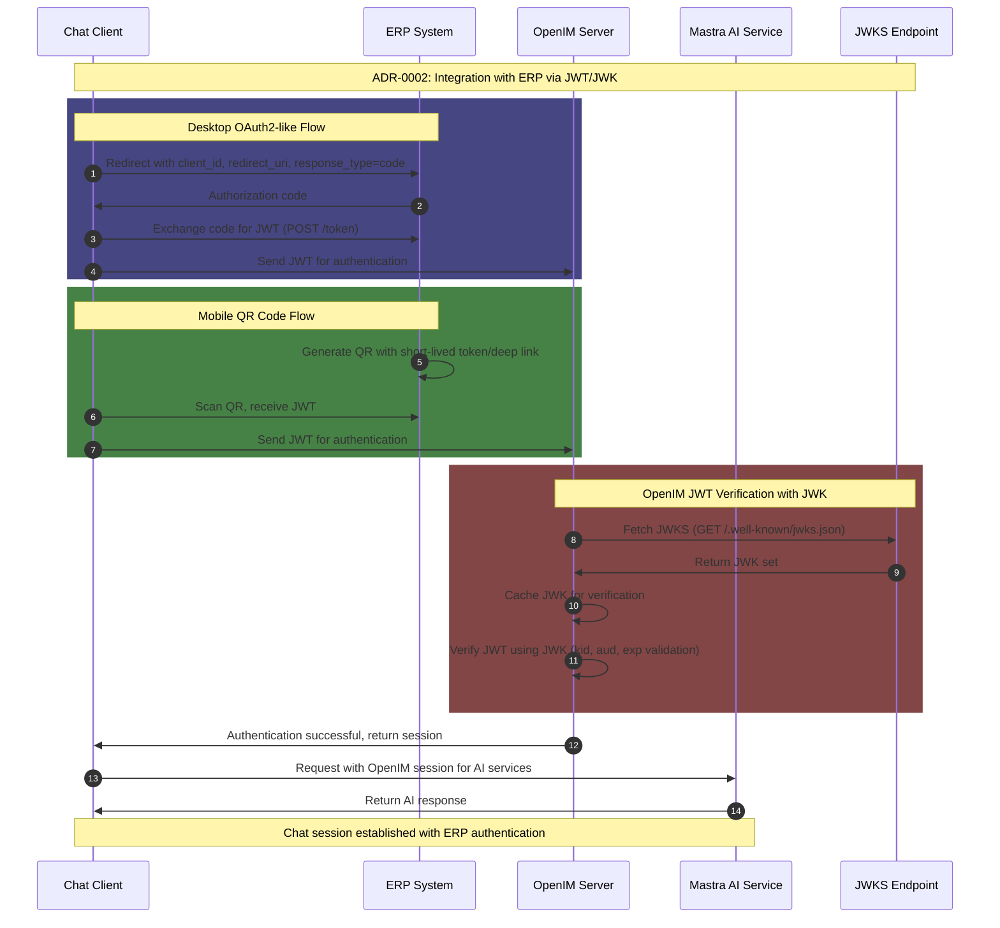

# [ADR-0002] Интеграция авторизации чат-сервиса с ERP через JWT и JWK

* **Status:** Proposed
* **Date:** 2025-11-07
* **Tags:** #auth #jwt #jwk #erp #openid-connect

## Контекст

Сервис чата (на базе Mastra и OpenIM) является отдельным от ERP-системы, которая выдаёт JWT-токены для аутентификации пользователей. Необходима безопасная авторизация:
- Для десктопа: через redirect в ERP и обратно (OAuth2-like flow).
- Для мобильного: через сканирование QR-кода, сгенерированного в ERP с авторизованным пользователем.

JWK (JSON Web Key) используется для верификации публичных ключей ERP в чат-сервисе, чтобы избежать передачи приватных ключей. Это обеспечивает децентрализованную верификацию JWT без доверия к третьим сторонам.

Текущий стек: OpenIM как IM-сервер для обработки чат-сессий, Mastra для ai-логики. Проект не имеет встроенной интеграции с внешними провайдерами аутентификации.

## Варианты решения

### Вариант 1: Модификация OpenIM для прямой проверки JWT от ERP

Реализовать авторизацию путём модификации аутентификационного слоя OpenIM для прямой верификации JWT от ERP:
1. **JWK-интеграция в OpenIM**: OpenIM будет запрашивать JWKS с эндпоинта ERP (например, `/.well-known/jwks.json`) и кэшировать его для верификации JWT. Библиотека: `jose` (для Go) или аналогичная.
2. **Десктопный flow**:
   - Клиент делает redirect на ERP с `client_id`, `redirect_uri`, `response_type=code`.
   - Обмен code на JWT через `/token` эндпоинт ERP.
   - Клиент отправляет JWT напрямую в OpenIM для аутентификации.
3. **Мобильный flow**:
   - ERP генерирует QR с short-lived токеном (или deep link: `chat://auth?token=...`).
   - Мобильное app сканирует QR, получает JWT и отправляет напрямую в OpenIM.
4. **Интеграция с Mastra**:
   - Использование существующих токенов OpenIM для аутентификации вызовов к Mastra.
5. **Безопасность**: Все запросы по HTTPS; ротация ключей через `kid` в JWK; аудитория (`aud`) в JWT только для чата; TTL токенов < 1h.

* **Плюсы:**
  - Безопасная децентрализованная верификация без хранения секретов в чат-сервисе.
  - Поддержка SSO: пользователи авторизуются один раз в ERP.
  - Легко расширяемо на другие клиенты (web/mobile/desktop).
  - Отсутствие дополнительных сущностей: используем только OpenIM и Mastra.
  - Решение масштабируемо и соответствует стандартам (RFC 7519, RFC 7517).
* **Минусы:**
  - Зависимость от доступности JWKS-эндпоинта ERP (нужен fallback с кэшем).
  - Необходимость модификации исходного кода OpenIM.
  - Потенциальные задержки при первом fetch JWKS (решается prefetch).

### Вариант 2: Использование middleware в существующих компонентах

Расширение существующих компонентов (OpenIM/Mastra) с использованием middleware для проверки JWT перед основной обработкой.

* **Плюсы:**
  - Минимальное вмешательство в существующую архитектуру.
  - Возможность повторного использования кода между OpenIM и Mastra.
* **Минусы:**
  - Требует модификации существующих компонентов.
  - Сложнее в поддержке и отладке.

## Решение

Выбранный вариант: **Модификация OpenIM для прямой проверки JWT от ERP**

* **Причины выбора:**
  - Соответствует современным стандартам безопасности (RFC 7519, RFC 7517).
  - Обеспечивает децентрализованную верификацию без хранения секретов в чат-сервисе.
  - Поддерживает ротацию ключей через JWKS endpoint.
  - Не требует добавления новых сущностей: используем только существующие компоненты (OpenIM и Mastra).
  - Относительно простое расширение аутентификационного слоя OpenIM.
* **Последствия:**
  - Требуется модификация исходного кода OpenIM для добавления JWT-валидации.
  - Необходимо интегрировать библиотеку `jose` или аналогичную для работы с JWT/JWK в OpenIM.
  - Потребуется реализация OAuth2 и QR-код flows в клиентских приложениях.
  - Потребуется обработка и кэширование JWKS для производительности в OpenIM.

## Дополнительные материалы

- RFC 7517: JSON Web Key (JWK)
- RFC 7519: JSON Web Token (JWT)
- OpenID Connect: Для redirect flow
- OpenIM docs: JWT integration (если доступно)
