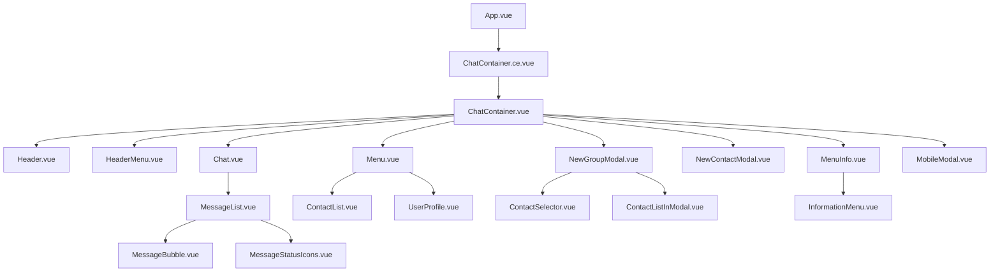
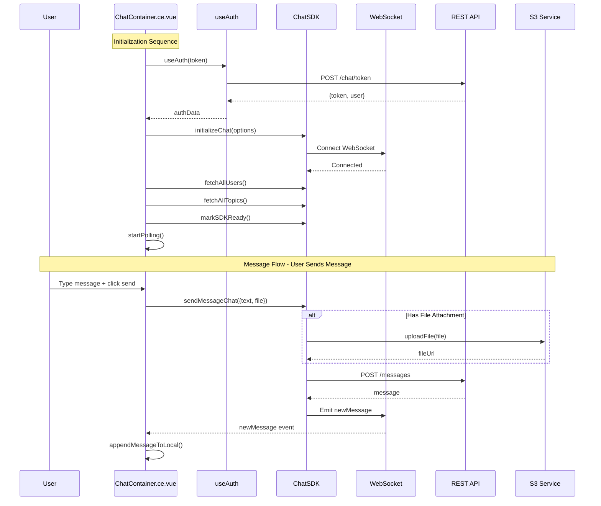
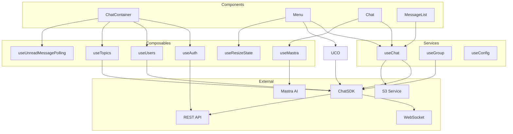
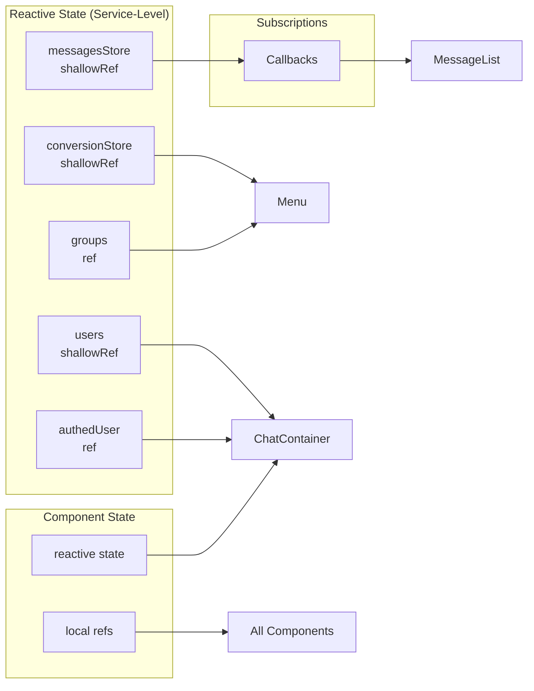
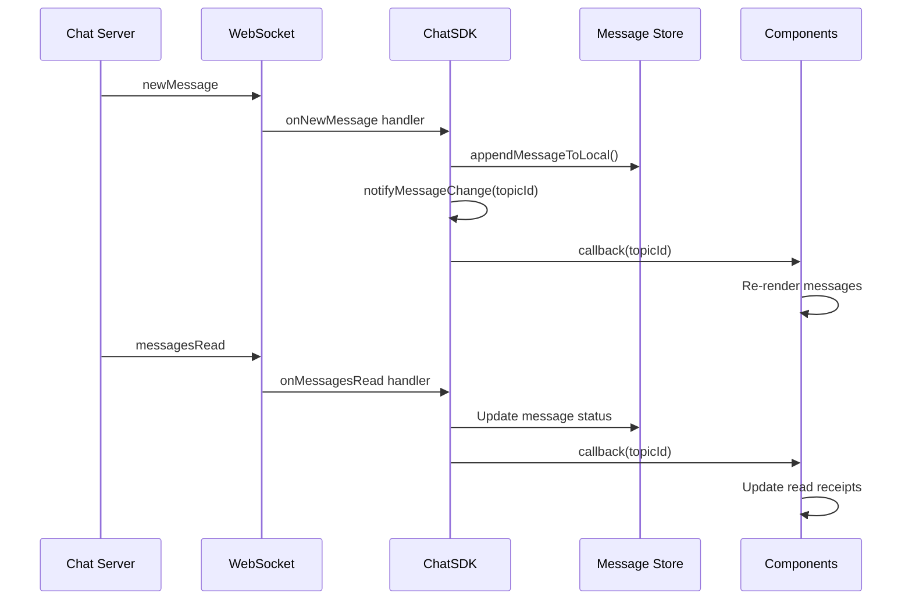
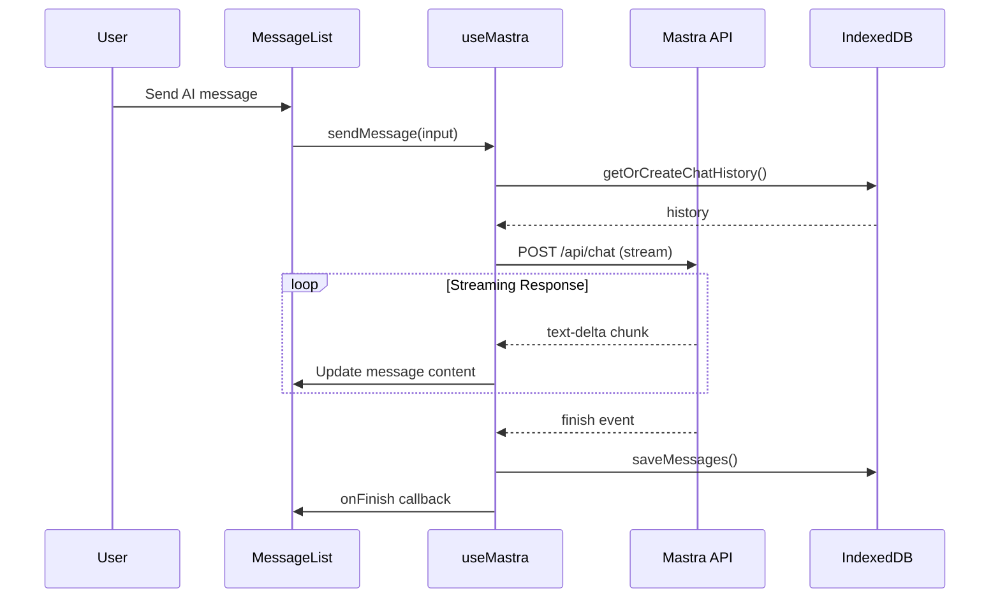
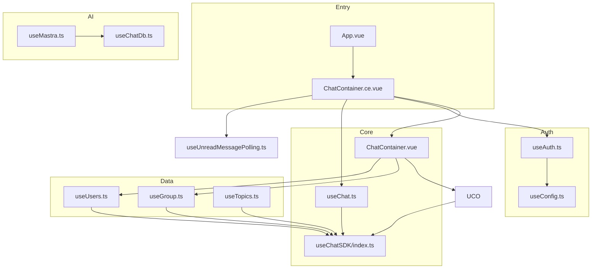

# Chat Client Architecture

## Overview

This document describes the architecture of the Chat Client Vue 3 application, including component hierarchy, data flow, and service interactions.

## Component Hierarchy



## Data Flow Architecture



## Service Layer Architecture



## State Management Pattern



## WebSocket Event Flow



## AI Assistant Integration



## Module Dependencies



## Key Patterns Used

1. **Observer Pattern**: Message subscriptions via callbacks
2. **Singleton Pattern**: ChatSDK instance
3. **Composition Pattern**: Vue 3 Composables
4. **Factory Pattern**: Message/User object creation
5. **Repository Pattern**: Service-level data stores

## File Structure

```
src/
├── components/           # Vue components
│   ├── Chat.vue
│   ├── ChatContainer.vue
│   ├── Header/
│   ├── ContactList/
│   ├── Messages/
│   ├── NewChat/
│   └── UserProfile/
├── composables/          # Vue composables
│   ├── useAuth.ts
│   ├── useUsers.ts
│   ├── useTopics.ts
│   ├── useResizeState.ts
│   ├── useMastra.ts
│   └── useUnreadMessagePolling.ts
├── services/             # Business logic services
│   ├── useChat.ts
│   ├── useGroup.ts
│   ├── useConfig.ts
│   └── useChatSDK/
│       ├── index.ts
│       ├── types.ts
├── utils/                # Utility functions
└── assets/               # Static assets
```
