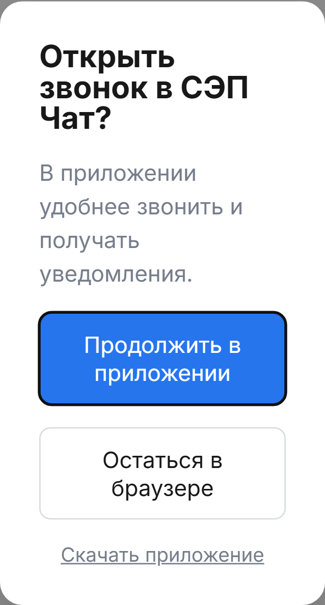
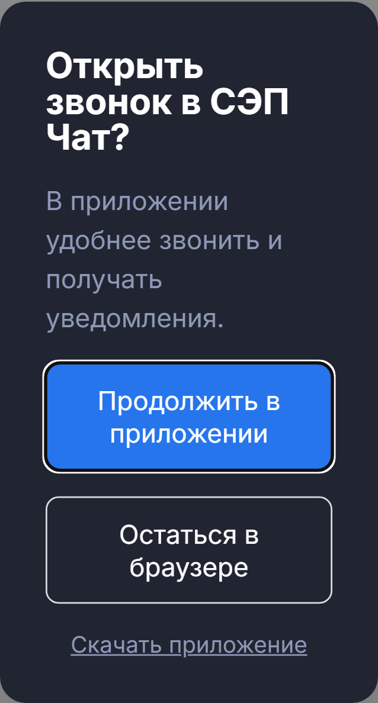

# Открытие приглашений на звонок

20 ноября 2026. Область изменения — приглашения вида
`https://chat.pksep.ru/?callRoom=…&callInvite=…&organization=…`.
Маршрут `/call/{topicId}` обозначает переписку звонка и не заменяет приглашение.

## Поведение

- В браузере, включая Android и iOS, до авторизации показывается выбор
  «Продолжить в приложении» / «Остаться в браузере».
- Нажатие ссылки внутри переписки проходит через тот же выбор. До решения
  пользователя веб-клиент не начинает присоединение к звонку.
- Android-кнопка использует `intent:` с HTTPS, фиксированным пакетом
  `sep.pksep.app` и возвратом на страницу выбора, если приложения нет.
  В приложение передаются только параметры приглашения. Рядом доступна
  существующая страница загрузки актуальной Android APK.
- В остальных браузерах сохраняется `sepchat://invite`. Нативный iOS-клиент
  переводит его в публичное HTTPS-приглашение и использует существующую очередь
  до авторизации. Tauri сохраняет свой обработчик.
- Решение остаться в браузере сохраняется в URL как `callClient=web`, включая
  переход на авторизацию. Новое приглашение снова предлагает выбор.
- Ответ предпросмотра сверяется с текущими приглашением, организацией и SDK.
  Запоздалый ответ не открывает старый звонок и не удаляет новую ссылку.
  Параллельное восстановление объединяется только для одного приглашения;
  завершение старого запроса не сбрасывает состояние нового.
- При завершении обработки удаляются и параметры приглашения, и временные
  маркеры выбора. При новой ссылке без организации прежняя организация не
  переносится. Приглашения не записываются в хранилища и диагностические логи.
- Счётчик веб-сборки повышен с 109 до 110.

## Проверки

- 15 Bun-тестов URL/очереди: кодирование `+`, `/`, `=`, проверка источника,
  запрет неоднозначных параметров, очистка посторонних данных, вход и дедупликация.
- 30 Playwright-проверок: Chromium desktop/Android и WebKit iPhone.
  Проверены холодное открытие до входа, сохранение браузерного выбора после
  перезагрузки/авторизации, новая ссылка и история, нажатие внутри переписки,
  запоздалый ответ и параллельное восстановление, нативные очереди Tauri/iOS.
  Диалог проверен в обеих темах на ширине 280 CSS px, с удержанием фокуса внутри.
- `bun run lint` прошёл: TypeScript и полный ESLint.
- `bun run build` прошёл: TypeScript, production Vite и генерация PWA.
  Остались прежние предупреждения о размере чанков/смешанных импортах.
- На физическом Pixel 5a домен `chat.pksep.ru` имеет состояние `verified`.
  Обычный системный HTTPS-resolver без явного package/component выбирает
  `sep.pksep.app/ru.pksep.chat.MainActivity`. Отдельно разрешается Android
  intent кнопки браузера. Подтверждён публичный assetlinks с двумя подписями.

Настоящие приглашения/звонки не запускались. Физическая проверка подтверждает
выбор Activity, а не реальное присоединение к комнате. Установки, сессии,
корпоративная ссылка и Xiaomi не менялись. Новая APK для этого исправления
не требуется: используется существующий HTTPS-обработчик Android.

Синтетические снимки узкого Android-браузера:

| Светлая тема | Тёмная тема |
| --- | --- |
|  |  |
