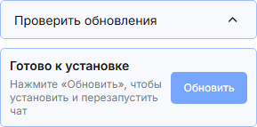
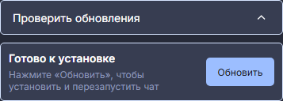

# Обновления SEP Chat Desktop

## Веб-сборка 111: переход в приложение и уведомления

Внизу списка чатов desktop-браузера вместо установки PWA находятся
«Открыть в приложении» (`sepchat://open`) и «Скачать приложение».
Браузеры не предоставляют надёжной проверки наличия обычного Tauri-приложения,
поэтому доступны оба действия. Внутри Tauri и мобильных клиентов этот desktop-блок
скрыт. Уже установленная desktop-PWA также предлагает перейти в Tauri.

Скачивание использует постоянные адреса без номера версии:

| Система | Адрес |
| --- | --- |
| Windows | https://chat-server-prod.pksep.ru/api/downloads/desktop/windows-x64 |
| Mac Apple Silicon | https://chat-server-prod.pksep.ru/api/downloads/desktop/macos-arm64 |
| Mac Intel | https://chat-server-prod.pksep.ru/api/downloads/desktop/macos-x64 |
| Linux | https://chat-server-prod.pksep.ru/api/downloads/desktop/linux-x64 |

Система пользователя стоит первой; оба варианта Mac доступны без угадывания
архитектуры по Safari. Публичные обработчики сервера используют готовый канал
`desktop-stable`, а не последний тег GitHub, который может ещё не иметь пакетов.

Перед решением об уведомлении Tauri получает свежий снимок системного окна.
Событие сворачивания и периодический опрос могут запаздывать относительно
сообщения; сохранённого focus недостаточно, чтобы подавлять уведомление
последнего чата. Своя кнопка сворачивания/закрытия сразу отмечает окно неактивным.
При возвращении в открытый чат лишнее уведомление не показывается.

20 ноября проверены настоящий Windows minimize и открытие `sepchat://open`
в работающий QA-процесс; 56 UI-проверок Chromium/WebKit/iPhone, 32 unit-теста,
полная сборка и ESLint. В сервере прошли 23 проверки раздачи установщиков.
Дополнительно прошли проверки компактных подтверждений на Mac под шапкой Tauri.
Новые desktop-пакеты по просьбе пользователя пока не публикуются.

## Оболочка и каналы обновления

Оболочка Tauri использует собственную шапку SEP Chat с цветами текущей темы,
перетаскиванием, двойным кликом для разворачивания и кнопками управления окном.
Закрытие по-прежнему скрывает окно в трей. Для системного fullscreen шапка скрывается.
Запрос микрофона/камеры оформлен компонентами проекта; отказ не запускает захват.
Подтверждения микрофона, камеры, геолокации, уведомлений и чтения буфера
сохраняются в профиле приложения (`chat.desktop.permissions.v1`) между
запусками и обновлениями. Значение содержит только решения о доступе, без
координат, содержимого буфера и учётных данных. Отказ или закрытие запроса
уведомлений/геолокации не вызывает новый автоматический запрос при каждом
запуске. «Не сейчас» в диалоге камеры/микрофона остаётся отменой текущего действия.
В профиле Tauri есть блок «Разрешения устройств» с кнопкой повторного запроса:
она сбрасывает ответы приложения для следующего запуска и не меняет настройки ОС.
Уведомления и геолокация проверяют актуальное системное разрешение; сохранённое
согласие не подменяет отозванный доступ. Обязательные системные запросы остаются
под управлением ОС. В Tauri/Wry 2.12/0.57 обработчик геолокации и буфера не
поддерживается на macOS: сохранение ответа приложения не гарантирует исчезновения
повторного системного окна macOS. Для проверки сохранения системного доступа
между выпусками нужен настоящий Mac и стабильная подпись приложения Apple.
Для экрана сначала проверяется существующее разрешение macOS; окно или экран
пользователь выбирает для каждой демонстрации. Выбор файлов и системные
разрешения на каталоги также не заменяются сохранённым ответом приложения.

В Windows и macOS выбор источника демонстрации — свой диалог «Весь экран» /
«Окно приложения». Только «Поделиться» запускает выбранный источник. Нативный
захват использует Windows Graphics Capture и ScreenCaptureKit, без временных
скриншотов, внешних терминалов и передачи системного звука. Кадры ограничены
1920×1080 и 30 fps; следующий кадр передаётся после обработки предыдущего.
Остановка трека, завершение звонка и перезагрузка страницы освобождают захват.
Имя источника и кнопка остановки видны в шапке во время демонстрации.

Минимальная macOS для этой нативной сборки — 12.3 (ScreenCaptureKit). Linux и
браузер сохраняют системный выбор getDisplayMedia; собственная рамка и запрос
устройств применяются только к Tauri. Системный портал Wayland остаётся частью
получения разрешения на захват.

`bun scripts/test-desktop-native-smoke.ts --shell` проверяет настоящую шапку,
диалог устройств с искусственным микрофоном/камерой и захват отдельного
синтетического окна Chromium. Обычные окна пользователя не захватываются.
Полученный трек проходит настоящий WebRTC encode/decode; отдельно проверяются
продолжение передачи при сворачивании Tauri и освобождение нативного захвата.

`bun run test:desktop:native --media` отдельно проверяет настоящие микрофон
и камеру через frontend-диалог разрешений проекта. Флаги искусственных устройств
в этом режиме не используются; звук и изображение не записываются и не
передаются. В отчёте остаются только состояние треков и технические параметры.
20 ноября WebView2 получил аудиотрек 48 кГц и видеотрек 640×480, затем оба
остановил. Это проверка локального захвата, а не разговора с другим участником.

macOS: повторное открытие из Dock возвращает скрытое или свёрнутое окно через
`RunEvent::Reopen`. Перезапуск после обновления использует `desktop_restart`,
который заранее переводит жизненный цикл в режим выхода; закрытие в трей
не должно перехватывать завершение приложения. Причина неудачной установки
или отложенного обновления показывается рядом с боковой кнопкой и в профиле.
Сбои desktop updater записываются в телеметрию с этапом и целевой версией.

Перед публикацией macOS-пакетов CI запускает
`bun scripts/test-desktop-updater-macos-native.ts` на Apple Silicon и Intel.
Стенд создаёт два отдельных QA-приложения и тестовую пару ключей, проверяет
отказ по повреждённой подписи, устанавливает настоящее подписанное обновление,
проверяет автоматический перезапуск, сохранение синтетической сессии/черновика
и отсутствие повторного предложения той же версии. Затем LaunchServices
повторно открывает закрытое в трей окно. QA-пакеты не публикуются;
отчёты сохраняются отдельно от установщиков, временные ключи и профили удаляются.

На Mac Retina координаты native drag от Wry 0.57 приходят в Cocoa points.
Клиент не делит их повторно на масштаб экрана. В Windows сохраняется перевод
из физических пикселей в CSS. HTML drag без MIME-метаданных сохраняет уже
распознанную нативную зону фото/видео. Для обычного окна вложений в macOS
задана высота по содержимому; WebKit и Chromium проверяются отдельно.

Windows: пользователю один раз передают NSIS `*-setup.exe`. Это установщик,
после установки приложение само проверяет новые версии при запуске, каждые
5 минут в открытом окне, при возвращении в окно (не чаще раза в минуту)
и после восстановления соединения. После ошибки проверка повторяется через
минуту. Найденный пакет автоматически скачивается в фоне и проверяется нативным
плагином по подписи. До успешного завершения загрузки боковой кнопки нет.
После проверки появляется «Обновить»: один клик сохраняет черновики,
устанавливает уже скачанный пакет и перезапускает приложение.

Раскрытие блока запускает новую проверку, если обновление ещё не найдено или
предыдущая попытка закончилась ошибкой. Найденный или скачанный пакет при
раскрытии сохраняется. Внутри раскрытого блока можно увидеть статус фоновой
подготовки или повторить неудачную проверку. Ошибка загрузки или подписи
не показывает боковую кнопку «Обновить»; автоматическая попытка повторится
через минуту. Временная ошибка сети или устаревший ответ CDN не отменяет
информацию о найденном релизе. В актуальном состоянии номер установленной
версии находится внутри описания раскрытого блока, как в Android.
Установка и перезапуск никогда не запускаются автоматически. Звонок, передача
файлов или несохранённые вложения откладывают установку; готовый пакет
сохраняется для следующего клика. После ошибки установки кнопка остаётся
доступной, а причина видна рядом с ней и в профиле.

Раскрытый блок обновлений на локальных тестовых данных:





macOS: первоначальная установка через DMG, обновления через подписанный
`app.tar.gz`. Linux: для встроенных обновлений распространять AppImage;
DEB/RPM обновляются средствами пакетного менеджера. Windows ARM64 пока
не собирается; поддерживается x64.

## Подпись и версия

Ссылки на звонок всегда используют `https://chat.pksep.ru`, включая ссылки,
скопированные из локального WebView Tauri. На компьютере страница звонка до
авторизации предлагает «Открыть SEP Chat» или «Продолжить в браузере». Это
работает и при ручном вводе URL. Кнопка приложения использует
`sepchat://invite?callRoom=...&callInvite=...&organization=...`; подтверждение
открытия установленного приложения показывает сам браузер. Если приложение
не установлено, рядом есть ссылка на установщики.

Desktop-пакет регистрирует протокол `sepchat`. Новый запуск и ссылка в уже
работающее приложение попадают в одну очередь, которая ждёт авторизации и
готовности SDK. Повторные события одного открытия не присоединяют к звонку
дважды. Android продолжает использовать существующие App Links. Для появления
предложения на публичном домене требуется отдельная выкладка веб-версии;
публикация установщиков на GitHub её не заменяет.

20 ноября 2026 года предложение проверено на публичной веб-версии 109
в новом браузерном профиле без входа. Переход из браузера в установленное
приложение с системным подтверждением остаётся отдельной ручной проверкой.
`bun run test:desktop:native --links` проверяет настоящий Windows launch URL
и передачу следующей ссылки из второго процесса в уже работающий Tauri.
Стенд использует отдельный identifier и dev-сборку, не заменяет регистрацию
протокола установленного приложения и не присоединяется к рабочим звонкам.

Закрытие desktop-окна в трей немедленно переводит его в фоновое состояние:
последний выбранный чат не считается открытым для чтения. Windows показывает
«Входящий звонок» с кнопками «Принять» и «Отклонить»; ответ и завершение звонка
убирают его уведомление. Стандартное контекстное меню WebView отключено только
в Tauri; собственные меню сообщений, файлов и чатов продолжают работать.

Используется существующая пара секретов репозитория:

- `TAURI_SIGNING_PRIVATE_KEY` — только CI, никогда не включается в приложение.
- `TAURI_UPDATER_PUBKEY` — публичный ключ, включается в нативный конфиг сборки.
- `TAURI_SIGNING_PRIVATE_KEY_PASSWORD` — нужен только если приватный ключ
  защищён паролем; для существующего ключа без пароля оставить незаданным.

`bun run tauri:build` требует приватный ключ и `DESKTOP_VERSION`.
Существующий публичный ключ сохранён в конфиге приложения и проверен по
подписанному desktop-релизу v1.6.6. Если в CI задан `TAURI_UPDATER_PUBKEY`,
он должен совпадать с этим ключом: случайная замена пары прерывает сборку.
Версия нативного приложения берётся из release tag `vX.Y.Z`, а не из
веб-счётчика `public/web-update.json` или старой версии Cargo.toml.
Разработка: `bun run tauri:dev`. Конфиг версии и канала генерируется перед сборкой.
Неподписанный пакет нельзя публиковать как автоматическое обновление.

Для первого установщика, передаваемого вручную, есть явный режим
`DESKTOP_VERSION=1.6.8 bun run tauri:build --bootstrap --bundles nsis`.
Он включает проверенный публичный ключ и updater, но не создаёт `.sig`
для самого первоначального установщика. Его можно установить вручную;
использовать такой пакет как автоматическое обновление нельзя. Последующие
CI-выпуски подписываются существующим приватным ключом.

Пакеты проверяются криптографически и в CI, и нативным updater при скачивании.
Ошибка подписи не переводит пакет в состояние готовности к установке.
Подпись обновлений Tauri не заменяет Authenticode / Apple Developer signing
и notarization. Подключение Developer ID, нотарификации и проверок Gatekeeper
описано в [настройке распространения macOS](macos-distribution.md).

## Публикация

До релиза workflow `Desktop Checks` проверяет упаковку Windows x64, Linux x64
и macOS ARM64/Intel в pull request. Его пакеты имеют тестовую версию
`0.0.0-beta.0`, собираются без приватного ключа и не публикуются в updater-канал.
Эта проверка не заменяет проверку подписей при выпуске.

Workflow `.github/workflows/desktop-builds.yml` собирает Windows x64,
Linux x64, macOS ARM64 и Intel. Он запускается для тегов `v*`, вручную с
существующим тегом или после успешного workflow Release. Последний путь
нужен потому, что теги от semantic-release с GITHUB_TOKEN сами не запускают
push workflows. При отсутствии нового релиза повторная сборка пропускается.

Публичные адреса без авторизации:

- stable: `https://github.com/pksep/chat_client/releases/download/desktop-stable/latest.json`
- beta: `https://github.com/pksep/chat_client/releases/download/desktop-beta/latest.json`
- пакеты: `https://github.com/pksep/chat_client/releases/download/vVERSION/PLATFORM-FILE`

Теги `vX.Y.Z-beta.N` используют отдельный beta-канал. Чтобы перейти со stable
на beta, сначала установить beta-сборку. Автоматического перехода между
каналами нет.

После успешной сборки **всех** платформ создаётся общий manifest. При
`publish=true` подписанные установщики сохраняются в соответствующем GitHub
Release: их можно скачать без входа и без ограничения срока хранения
CI artifacts. Имя начинается с платформы, пробелы заменяются дефисами;
существующий файл с другой SHA-256 не перезаписывается.

Только после загрузки всех пакетов и проверки их публичных URL workflow
обновляет `latest.json` в служебном релизе `desktop-stable` или `desktop-beta`.
Служебные релизы помечены prerelease и не становятся последним обычным релизом:
semantic-release продолжает выбирать версию из `vX.Y.Z`. Если сборка или
загрузка пакетов не завершилась, прежний manifest остаётся доступен.
При замене самого JSON возможен краткий 404 между удалением и загрузкой asset;
клиент показывает сетевую ошибку и допускает повтор, установка не начинается.
По завершении CI проверяет публичный manifest и HEAD каждого пакета.

Нужны только `GITHUB_TOKEN` с `contents: write` в publish job и секреты подписи
Tauri. SSH, Kubernetes-хранилище и веб-прокси для desktop больше не используются.
Репозиторий должен оставаться публичным: приватный GitHub Release требует
авторизации и недоступен обычному клиенту. Сборка с `publish=false` даёт только
CI artifacts; `publish=true` вручную или автоматический tag/release публикует
установщики и канал обновлений.

Версии со старым адресом `chat.pksep.ru/desktop/...`, включая локальную 1.6.10,
нужно один раз заменить новым установщиком. После этого новые версии
скачиваются с GitHub и проверяются существующим публичным ключом Tauri.

Для повтора публикации без компиляции всех платформ укажите тот же `tag`,
`publish=true` и `artifact_run_id` завершённого Desktop Builds для этого тега.
Workflow проверяет коммит, успешность всех четырёх сборок и наличие artifacts,
затем повторно проверяет криптографические подписи пакетов перед выкладкой.
После успешной проверки опубликованного канала временные CI artifacts удаляются;
окончательные установщики и подписи остаются в GitHub Releases. При ошибке
публикации artifacts сохраняются до 30 дней для повтора через `artifact_run_id`.

## Сохранение работы

Windows NSIS сохраняет старый каталог установки после переименования в «СЭП Чат».
Перед сравнением целей ярлыков установщик раскрывает короткие имена Windows 8.3
в полный путь, который возвращает ShellLink.
При первом обновлении с исправлением миграции установщик восстанавливает ярлыки
рабочего стола и меню «Пуск», в том числе если предыдущий релиз уже удалил оба.
Ярлык `SEP Chat` удаляется только после проверки цели нового ярлыка и только
если старый указывает на этот же экземпляр приложения. Маркер
`ShortcutMigrationVersion` сохраняется в ключе продукта: следующие обновления
не создают заново ярлыки, которые пользователь удалил вручную. Явный флаг `/NS`
запрещает создание ярлыков; при новой установке остаётся штатный выбор NSIS.
`bun scripts/test-windows-shortcuts.ts` проверяет миграцию настоящими NSIS/COM
на временных ярлыках и отдельном ключе реестра, после сборки NSIS-пакета.

Установка проверяет активный, входящий и исходящий звонок, операции ChatSDK,
скачивание/сохранение нативных файлов. Перед выходом выполняется Vue nextTick
и синхронная запись текстового черновика. Во время сохранения блокировки
проверяются повторно. Файлы, ещё прикреплённые к черновикам, нужно отправить
или удалить: текущий ContentEditor хранит их только в памяти. Сессия и
localStorage сохраняются в том же профиле Tauri; установщик не очищает их.

На macOS после сохранения черновиков подготовка установки дополнительно ждёт
две секунды: WebKit записывает localStorage отложенной транзакцией. Затем
повторно проверяются нативные передачи, звонки и другие блокировки. Проверка
настоящего обновления использует эту же подготовку и проверяет сохранение
сессии и свежего черновика даже при первом обращении к localStorage перед
перезапуском. Отдельный workflow `macOS Updater Check` запускает её без
публикации пакетов на Intel и Apple Silicon.

## Проверки

17 ноября 2026 первый релиз с каналом GitHub `1.49.2` успешно собран для всех
четырёх платформ и [опубликован CI](https://github.com/pksep/chat_client/actions/runs/44077344317).
Публичный `desktop-stable/latest.json` и ссылки пакетов проверены без авторизации.
Windows EXE повторно скачан с GitHub: SHA-256
`c5a110003c184dc47b9b31ccaa8b01dc6256e4dc2cbd8bc62bfcad5a3c440794`,
подпись Minisign проверена существующим публичным ключом Tauri. Временные
архивы CI после проверки удалены; установщики и подписи сохранены в релизе.

```sh
bun test ./test/desktopUpdater.test.ts ./test/desktopRelease.test.ts
bun x playwright test e2e/tauri-updater.spec.ts --project=chromium-desktop
cargo check --manifest-path src-tauri/Cargo.toml --locked
```

`bun scripts/test-desktop-updater-native.ts` — отдельная проверка настоящего
Windows NSIS updater: две локально подписанные QA-сборки, отказ при неверной
подписи, обновление 1.6.100 → 1.6.101, автоматический перезапуск и проверка
синтетической сессии/черновика. Она использует отдельный identifier
`ru.pksep.chat.updaterqa`, папку `.codex/desktop-updater-native`, тестовый ключ
и локальный порт 17883. HTTP разрешён только в её отдельном тестовом конфиге.
Эта проверка не публикует QA-пакеты в production.

Проверено 16 ноября 2026 на Windows: настоящая установка 1.6.100 → 1.6.101
успешна, приложение перезапустилось; синтетическая сессия и русский черновик
сохранились. Пакет с изменённой подписью отклонён. QA-приложение остановлено
и удалено его собственным uninstaller. Также прошли 14 unit-проверок,
18 проверок профиля desktop/mobile (включая реальные флаги звонка и передачи,
раскрытие без запросов и неизменные размеры в обеих темах, 280/391 px,
при масштабе 100/130%),
Rust check, TypeScript и проверка nginx
в Docker: manifest/no-store, пакет/immutable, отсутствующий файл/404.
Дополнительный старый web-menu smoke имел таймаут первого холодного запуска
в dev-сервере; это не засчитано как полностью успешный прогон всей веб-сюиты.
Production-манифест и первая матрица CI этим локальным тестом не проверялись.

Desktop-иконки генерируются отдельно от 16-битных PWA PNG: упаковщику macOS
нужны RGBA8 и поддерживаемые размеры ICNS. PNG 1024×1024 обозначен `@2x`,
поскольку это retina-вариант 512×512. Проверка этих требований входит в unit-набор.

Финальная preview-матрица [43890257051](https://github.com/pksep/chat_client/actions/runs/43890257051)
не смогла запустить jobs: GitHub сообщил о проблеме оплаты аккаунта или лимите
расходов. Это не успешная проверка macOS/Linux. Локальная Windows-сборка
с текущим интерфейсом завершилась, установленный exe и share-установщик обновлены.

Основной Windows-установщик 1.6.8 собран в режиме bootstrap
и скопирован в `../artifacts/share/SEP-Chat-Desktop-1.6.8-setup.exe`.
Установленный `C:/Users/edgar/Applications/SEP Chat/sep-chat.exe` обновлён
этой сборкой: версия файла 1.6.8, SHA-256 совпадает с release exe,
процесс после запуска отвечает. Тестовые updater-серверы остановлены.
Этот bootstrap-установщик предшествует переходу на GitHub Releases и содержит
старый адрес обновлений; для нового канала его нужно заменить свежим CI-пакетом.
