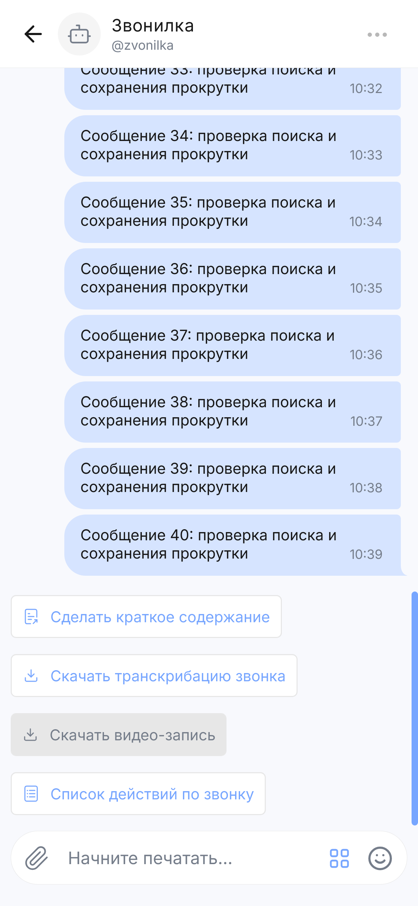
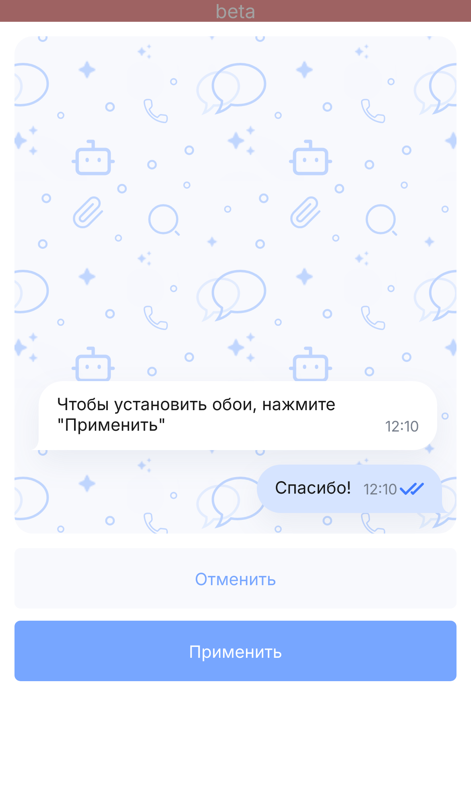
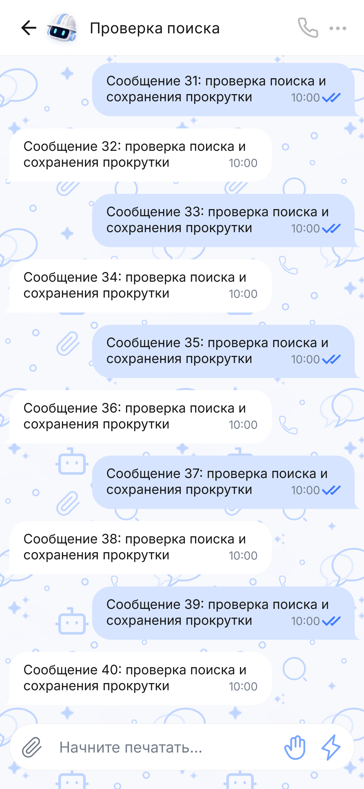
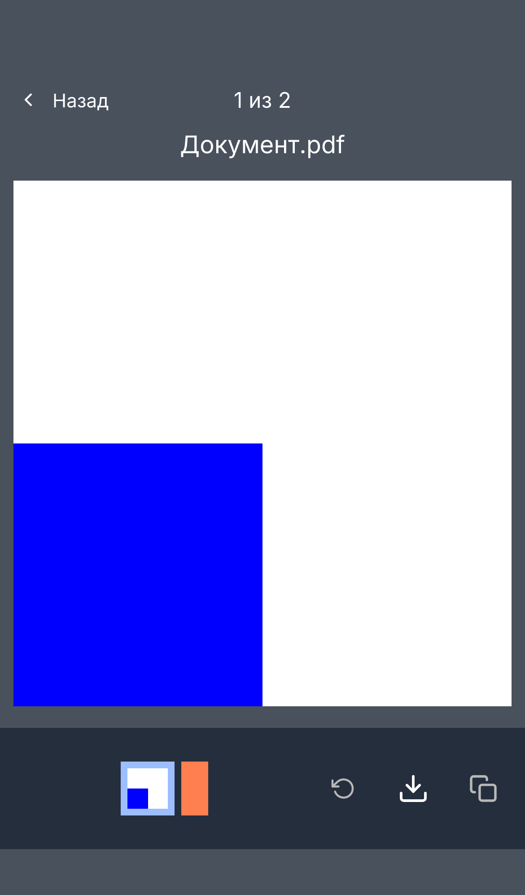

# Замечания от 29 октября 2026

Источник: сегодняшние сообщения и четыре скриншота в [группе проблем iPhone](https://chat.pksep.ru/group/9f839669-13b7-4a0b-ab77-ddd64863b1b2), 14:20–14:33. Старые замечания в эту работу не включались. Изменения подготовлены к выпуску веб-версии 91.

## План и изменения

1. **Камера.** Не удалять input после пустого `change` или `cancel`, пока WebKit ещё готовит снимок. После возвращения в приложение дождаться файлов в течение ограниченного времени, скопировать байты и передать вложение один раз. Дождаться асинхронного обработчика до очистки input.
2. **Стикеры.** Ограничить время запроса; повторять временные сетевые ошибки и ответы 408/429/5xx не более двух раз. При 401 использовать общее обновление сессии с повторным чтением токена. После возвращения сети или приложения повторно загружать открытый каталог с ошибкой.
3. **Аватар.** Сохранять известный аватар при частичном обновлении того же пользователя, в том числе в сохранённой сессии. Явные `null`/пустая строка и смена пользователя сбрасывают фото. Неудачно загруженный видимый аватар получает ограниченные повторы, а также восстановление по возвращению сети/приложения.
4. **Звонилка.** Не скрывать всю панель действий при отсутствии описания группы. Получать ID комнаты из служебного сообщения в полном локальном хранилище, даже когда оно находится за пределами отображаемого окна истории. Использовать этот ID для запроса записи и действий.
5. **Слайдер.** Убрать мобильный зазор 20 px между верхней панелью и именем файла. Сохранить системные безопасные области и доступность нижних кнопок после изменения viewport.
6. **Предпросмотр обоев.** Учитывать padding внутри размера поверхности и убрать внутренний `min-height: 100%`, выталкивавший исходящее «Спасибо!» за нижнюю границу. Проверены высоты 844 и 667 px.
7. **Обои ИИ.** Исключить маршрут ИИ из мобильного правила, сбрасывавшего фон через `background`. Использовать общее правило обоев для чатов, ИИ и отдельного слоя Android.

## Проверки

- `bun run test:e2e e2e/ios-pwa.spec.ts e2e/external-avatar.spec.ts e2e/slider-pdf-loading.spec.ts e2e/sticker-picker.spec.ts --workers=1 --reporter=line`: 124 сценария пройдены в Chromium desktop/mobile и WebKit iPhone PWA, 40 штатно пропущены для неподходящих проектов браузеров.
- Проверены фото и видео, возврат из камеры без события, задержанный файл, пустые `change/cancel`, отсутствие дубликатов и сохранность байтов загрузки; восстановление стикеров после 503/возвращения сети и обновление токена после 401; аватар, кнопки звонилки, обои и размеры слайдера.
- Обновление сессии и выход: 19 модульных тестов, включая сохранение аватара при refresh до и после загрузки профиля.
- `bun run lint` (проверка типов и ESLint всего `src`) и `git diff --check` — без ошибок.
- `bun run build:prod` — успешно, включая генерацию service worker PWA. Vite вывел предупреждения о размере чанков и совмещении статических/динамических импортов.

Системная камера физического iPhone не подключалась: её возврат проверен через воспроизведение событий в WebKit. Скриншоты пользователей в репозиторий не добавлялись. Используется публичный `@pksep/yui@0.1.353`; номер веб-версии — 91.

## Скриншоты WebKit с тестовыми данными

| Кнопки звонилки без описания группы | Предпросмотр обоев |
| --- | --- |
|  |  |

| Обои на маршруте ИИ | Слайдер PDF |
| --- | --- |
|  |  |
