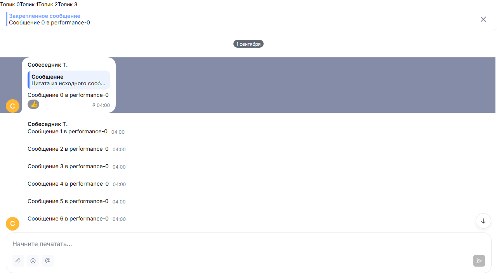
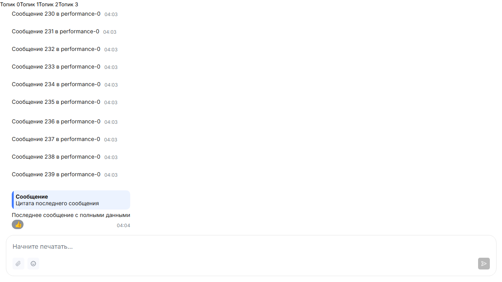
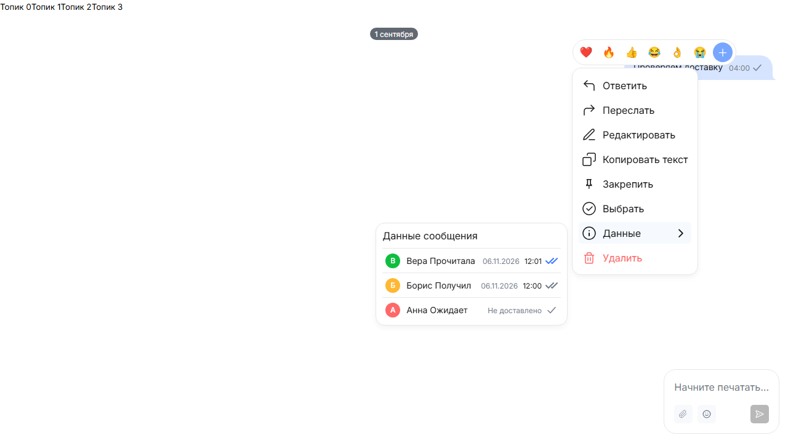

# Переходы по сообщениям и контекстное меню

Дальний переход к закрепу использует короткое движение и смену видимого контекста. Перед показом загружается полное окружение сообщения: цитата, реакции, автор и соседние сообщения появляются вместе. Контекст текущего закрепа предварительно загружается с объединением повторных запросов.

Кнопка перехода вниз сразу показывает конец истории из памяти. Анимация длится 140 мс, свежая история запрашивается параллельно и применяется после завершения перехода. Ручная прокрутка и смена чата отменяют ожидающее перемещение. При включённом уменьшении движения содержимое переключается без анимации.

Открытие панели «Данные» сохраняет положение меню и реакций. В избранном пункт «Данные» скрыт. В остальных чатах длинный список получателей прокручивается со скрытой полосой прокрутки.

## Проверка

```sh
bun run lint
bun run test:e2e e2e/message-delivery-status.spec.ts e2e/pinned-message-startup.spec.ts e2e/unread-and-pinned-history.spec.ts e2e/pinned-message-transition.spec.ts e2e/scroll-to-bottom-transition.spec.ts e2e/network-requests.spec.ts --project=chromium-desktop --project=chromium-mobile --workers=1 --timeout=60000 --reporter=line
```

Сценарии проверяют геометрию сообщений по кадрам, готовность цитат и реакций, появление локального конца истории менее чем за 150 мс при задержанном HTTP-ответе, отмену переходов и прокрутку списка из 40 получателей.

## Скриншоты

Скриншоты получены в изолированных Playwright-страницах с тестовыми данными.

Переход к закрепу:



Конец истории после фонового обновления:



Контекстное меню и панель данных:


