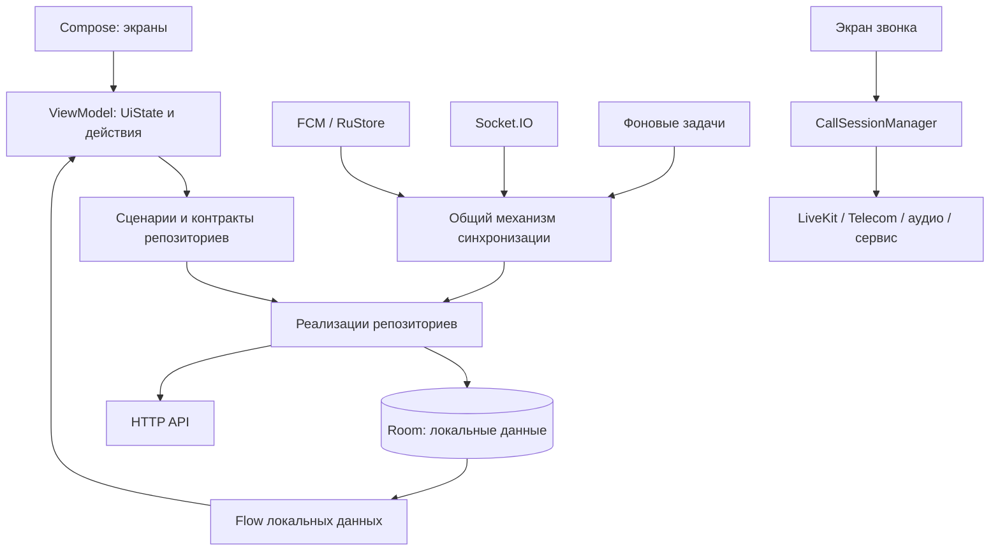

# План нативного Android-приложения SEP Chat

Дата: 27 октября 2026. Статус: реализация начата в отдельном `chat_android/`; первый срез проверяется на Pixel.

Уточнение: реализацию выполняет основной агент с подагентами. План пересмотрен под параллельную работу; прежняя оценка 5–8 месяцев снята как не откалиброванная для этой организации разработки.

## 1. Цель и принятые предположения

Создать самостоятельный нативный Android-клиент на Kotlin с качеством промышленного мессенджера. Перенести все пользовательские функции текущего приложения: переписку, папки, контакты, группы, медиа, стикеры, звонки, клиентов, AI и настройки.

**Внешний вид всех экранов должен точно повторять текущий Vue-клиент `chat_client`. Эталон поведения — Telegram для Android.** Vue определяет цвета, шрифты, размеры, расположение элементов и ресурсы. Спорные поведенческие ограничения можно пересматривать. В частности, ожидание HTTP при каждом открытии сохранённого чата заменяется немедленным показом локальной истории с обновлением в фоне.

Под соответствием Telegram понимается поведение существующих функций проекта. Для него нужно составить проверяемую спецификацию: жесты, переходы, прокрутка, состояния сети, отправка, уведомления и звонки. Пользовательские роли, доступ к обращениям и подтверждения действий AI сохраняют правила SEP.

Серверные сервисы продолжают работать как общая система для всех клиентов. План предусматривает необходимые совместимые дополнения API; объём обнаруженных пробелов уточняется на первом этапе. Нативный проект предлагается разместить в отдельном `chat_android/` рядом с `chat_client/`.

По дополнительному разрешению пользователя контракты, мешающие правильному поведению Android, можно развивать через новые маршруты v2. Они вводятся параллельно с v1; существующий веб-клиент сохраняет прежние пути, payload и семантику. Совместная работа версий покрывается серверными контрактными тестами, а Android переключает версии в адаптере данных.

## 2. Что изучено и что определяет объём

Проведён статический обзор структуры системы, основных контрактов и сложных реализаций. Это не построчное ревью всего кода и не проверка работоспособности всех функций на устройстве.

| Часть | Наблюдение | Следствие для Android |
| --- | --- | --- |
| `chat_client` | Vue 3, TypeScript, Capacitor; 183 Vue-компонента и 60 Java-файлов в основной Android-части на момент обзора | Нужно перенести интерфейс и существующую платформенную логику |
| `chat_server` | NestJS, HTTP API, Socket.IO, общий пакет Zod; отдельные домены сообщений, папок, медиа, звонков, доступа и клиентов | Нужны Kotlin-контракты и проверка совместимости обоих транспортов |
| Синхронизация | PTS/replay, снимок списка чатов с собственным курсором, пагинация, локальные удаления, очередь отправки | Это отдельная подсистема с транзакциями и восстановлением после завершения процесса |
| Идентичность сообщений | Локальные сообщения связываются с серверными через `ex.clientId`; сервер использует блокировку и проверку повторов | Сохраняем этот контракт для безопасных повторных отправок |
| Android | FCM и RuStore Push, фоновые workers, обработка уведомлений, загрузка файлов, входящие звонки, MediaProjection | Необходимо заменить Capacitor-мосты нативными компонентами |
| Звонки | LiveKit, групповые комнаты, приглашения, демонстрация экрана, аудиомаршруты, фон/размытие, реакции и поднятая рука | Совместимость Android SDK и обработку фона нужно доказать ранними прототипами |
| Авторизация | SEP Auth и прокси чата, ротация refresh-cookie, отдельные варианты access-токенов | Нужен единый безопасный менеджер сессии для UI, сети и фоновых задач |
| Клиенты | Обращения, очереди, ответственные, папки, доступ, ERP-связи и конфликты версий | Это самостоятельный функциональный блок с серверными бизнес-правилами |
| AI | Mastra/SSE, история, вложения, речь, задачи и подтверждаемые действия | Потребуется нативный клиент протокола с восстановлением результата после обрыва |
| Остальная система | `chat_sync`, `sep-auth`, `notifications`, `chat_ai`, `sep-bot`, `bot-api`, конфигурация инфраструктуры | Их функции учитываются через интеграции; серверные компоненты остаются на сервере |

Основной изученный клиент: `chat_client`, ветка `chat-546`, HEAD `50d64e29`. Дополнительно учтены документы завершённой работы `chat-540`. Перед разработкой фиксируется единая актуальная базовая ревизия и матрица возможностей.

## 3. Поведение приложения по образцу Telegram

Следующие правила — целевая спецификация. Точные жесты и переходы сверяются с актуальным Telegram Android на этапе 0 и закрепляются примерами и тестами.

| Сценарий | Целевое поведение | Что проверяем |
| --- | --- | --- |
| Повторный запуск | Сохранённые чаты появляются без ожидания сети; сверка с сервером идёт в фоне | Медленные API, обновление сессии и фоновые задачи не блокируют локальный экран |
| Открытие сохранённой переписки | Локальная история отображается сразу при доступной сети и без неё | Нет полноэкранного скелетона поверх доступной истории и кадров другого чата |
| Первая загрузка | Когда локальной истории нет, показываем понятное состояние загрузки и возможность повторить запрос | Ошибка не превращается в бесконечный индикатор или ложную пустую историю |
| Недоступный сервер | Доступная локальная переписка остаётся на экране; состояние соединения видно без блокировки работы | Таймаут не разлогинивает пользователя и не очищает данные |
| Отправка | Сообщение сразу появляется локально; часы сменяются подтверждённым статусом | Повтор запроса и поздний ответ не создают дубль и не меняют визуальный ключ строки |
| Отправка без сети | Текст и очередь сохраняются на диске; отправка продолжается после восстановления связи | Завершение процесса между нажатием «Отправить» и ответом сервера не теряет сообщение |
| Прочтение | Отмечаем действительно показанные сообщения активного чата; синхронизируем состояние между устройствами | Фоновая загрузка и переход по уведомлению сами по себе не означают прочтение |
| Вход в историю | При входе с непрочитанными показываем соответствующую границу; при возврате к просмотренной истории сохраняем позицию | Точное поведение возврата фиксируется отдельно для навигации и восстановления процесса |
| Прокрутка | Сохраняем видимый якорь при подгрузке, обновлении медиа, реакции и изменении сообщения | Новое сообщение не уводит пользователя вниз, если он читает старую историю |
| Черновик | Текст, форматирование, ответ и выбранные вложения переживают переходы и завершение процесса | Смена чата, клавиатуры или экрана звонка не теряет ввод |
| Между устройствами | Сообщения, чтения, удаления, настройки и доступ согласуются через сервер | Для черновиков и других состояний отдельно проверяем наличие серверного контракта |
| Поиск | Локальные результаты появляются быстро; сервер дополняет их по мере ответа | Переход к найденному сообщению сохраняет контекст истории |
| Жесты и действия | Ответ свайпом, долгое нажатие, выделение, пересылка и меню работают согласованно | Жесты не конфликтуют с системным Back, выделением текста и прокруткой |
| Файлы | Превью, прогресс, отмена, повтор и продолжение загрузки; кешированные медиа доступны локально | Большой файл не загружается целиком в оперативную память |
| Папки и счётчики | Фильтры, порядок и непрочитанные согласованы между списком, разделами и уведомлениями | Частичный ответ и повторное событие не увеличивают счётчик второй раз |
| Уведомления | Одно логическое уведомление на событие; переход в нужный чат; поддержка действий из уведомления | FCM, RuStore и Socket.IO не создают повторные уведомления |
| Звонки | Ответ с заблокированного экрана, управление звуком, продолжение при сворачивании, возврат в звонок | Отмена и ответ на другом устройстве снимают устаревший входящий вызов |
| Разрешения | Запрашиваем камеру, микрофон и другие разрешения при использовании соответствующей функции | Первый запуск и чтение чатов не прерываются серией необязательных диалогов |

Для бизнес-разделов без прямого аналога в Telegram применяются те же принципы отзывчивости и сохранности состояния. Подтверждение действия AI и проверка прав на обращения остаются обязательными.

## 4. Технологические решения

| Область | Решение | Основание |
| --- | --- | --- |
| Язык | Kotlin | Coroutines, Flow, null safety и основная современная Android-экосистема |
| UI | Jetpack Compose, собственная дизайн-система на базе Material 3 | Нативные экраны и управление состоянием с сохранением визуального стиля SEP |
| Состояние | ViewModel, неизменяемый `UiState`, однонаправленный поток событий | Предсказуемые переходы и проверяемые состояния экрана |
| Конкурентность | Coroutines, structured concurrency, Flow/StateFlow | Управляемая отмена, сериализация изменений и привязка к жизненному циклу |
| DI | Hilt | Явное создание зависимостей и контролируемое время жизни |
| HTTP | Retrofit + OkHttp, Kotlin Serialization | Типизированные контракты, управление сессией, потоковая передача файлов |
| Realtime | Совместимый Socket.IO JVM-клиент | Сервер использует Socket.IO; обычного WebSocket-клиента недостаточно |
| Хранилище | Room; DataStore для небольших настроек | Транзакции, индексы, миграции и реактивное чтение данных |
| Фон | WorkManager; foreground service для допустимых длительных операций | Восстановление отложенных задач с учётом ограничений Android |
| Медиа | Coil, Media3, CameraX по необходимости | Изображения, воспроизведение и захват через стандартные компоненты |
| Вызовы | LiveKit Android SDK, системная интеграция через Jetpack Core-Telecom/Telecom | Управление звонком независимо от экрана; окончательный вариант подтверждается прототипом |
| Push | Общий интерфейс над FCM и RuStore | Единая обработка событий и независимость бизнес-логики от провайдера |
| Сборка | Gradle Kotlin DSL, version catalog, convention plugins | Воспроизводимость, единые настройки и контроль зависимостей |

Точные совместимые стабильные версии фиксируются на этапе 0. Исходная нижняя граница — Android 8/API 26, как в текущем приложении. Сейчас проект использует compile/target API 36; требования SDK и магазинов проверяются повторно перед выпуском.

Java остаётся допустимым для проверенных переиспользуемых платформенных компонентов. Новый прикладной код пишется на Kotlin. Готовность каждого переносимого Java-компонента проверяется отдельно: часть текущего кода тесно связана с WebView и Capacitor.

## 5. Архитектура и границы ответственности

Применяется модульная архитектура по функциональным областям. Разделение presentation/domain/data вводится там, где оно отделяет реальные обязанности. Отдельный use case нужен для правил и координации операций; простое чтение репозитория не требует обязательной дополнительной обёртки.



**Room является единым источником сохраняемых данных для UI.** Сетевые ответы сначала согласуются и сохраняются, затем экран получает обновление через Flow. Индикатор набора, состояние соединения и живые медиатрэки хранятся как временное состояние сессии.

Начальная структура, названия которой уточняются при создании проекта:

```text
chat_android/
  app/                       # composition root, навигация, запуск
  build-logic/               # единые настройки Gradle
  core/model/                # простые общие типы и идентификаторы
  core/network/              # HTTP, сериализация, транспортные ошибки
  core/database/             # Room, DAO, транзакции, миграции
  core/designsystem/         # токены и общие Compose-компоненты
  core/testing/              # общие тестовые инструменты
  domain/chat/               # контракты и сложные сценарии чата
  data/session/              # сессия, cookie, refresh, доступ
  data/chat/                 # репозитории, синхронизация, outbox
  feature/auth/
  feature/chats/             # список и переписка, сначала один модуль
```

По мере реализации добавляются `platform/notifications`, `platform/calls`, `data/media`, `data/clients`, `data/assistant`, соответствующие feature-модули и настройки. Самостоятельный модуль создаётся при наличии полезной границы зависимостей или жизненного цикла. Деление каждого экрана на несколько Gradle-модулей заранее не требуется.

Основные правила кода:

- Экраны не выполняют HTTP, SQL и операции с Socket.IO; ViewModel не управляет живыми медиатрэками звонка.
- DTO, Room Entity, доменная модель и экранное состояние разделяются на границах с явным преобразованием.
- Feature-модули не вызывают внутреннюю реализацию друг друга; переходы связывает приложение.
- UI и workers используют одни репозитории и правила синхронизации. Отдельного фонового варианта бизнес-логики нет.
- Изменения синхронизации проходят через согласованный обработчик и транзакции; публичные глобальные изменяемые хранилища и общий event bus не используются.
- Ошибки различают недоступность сети, отказ авторизации, запрет доступа, конфликт и повреждённый контракт. Отмена coroutine не превращается в обычную сетевую ошибку.

## 6. Решения, от которых зависит надёжность

### 6.1. Синхронизация и отправка

1. Сообщения, очередь отправки, черновики, настройки, подтверждённые снимки, курсоры и отметки удаления сохраняются с привязкой к серверу и пользователю.
2. Запись локального сообщения и задания outbox выполняется одной транзакцией. Стабильный `clientId` сохраняется при всех повторах и передаётся через существующий `ex.clientId`.
3. Выбирается один основной путь отправки сообщения; HTTP и Socket.IO не запускают параллельное создание одного сообщения. Поздний ответ, push и realtime согласуются по идентичности.
4. События и соответствующий курсор фиксируются атомарно. Подтверждённый курсор списка чатов независим от курсора realtime, как требует текущий `/topics/sync`.
5. Повторы, дубли, изменение порядка доставки и потеря ответа обрабатываются без повторного применения эффекта. PTS не трактуется как обязательно непрерывный счётчик пользователя: журнал фильтруется по доступным чатам.
6. HTTP-ответ не перезаписывает более свежее realtime-изменение. Удалённое сообщение не возвращается из старого кеша или позднего ответа.
7. Удаление доступа к чату учитывается отдельной сверкой состава; одного replay недостаточно. Подтверждённый сервером пустой ответ отличается от сетевой ошибки.
8. Очередь сохраняет порядок зависимых действий одного чата, использует ограниченный backoff с jitter и умеет продолжать работу после завершения процесса. Разные чаты и фоновые загрузки не блокируют друг друга без необходимости.
9. Неидемпотентные команды вроде `toggleReaction` нельзя слепо повторять после неопределённого результата. Нужны сверка состояния либо совместимое серверное дополнение с явным желаемым значением/ключом операции.
10. После reconnect, возврата из фона и утраты журнала выполняется сверка либо новый снимок. Чтение локального состояния для первого кадра не ждёт завершения этих операций.

### 6.2. Сессия и доступ

- Один SessionManager обслуживает HTTP, Socket.IO, workers и действия уведомлений. Одноразовая refresh-cookie обновляется строго последовательно.
- Нативный CookieJar сохраняет атрибуты cookie и принимает ротацию. Для прокси чата учитывается `chat_refresh_token` с `Path=/api/auth`; прямой SEP Auth использует другой контракт. Рабочий путь фиксируется по фактическому окружению.
- Секреты сессии шифруются ключом Android Keystore; обычный DataStore не считается защищённым хранилищем токенов. Пароли и серверные служебные ключи в APK не сохраняются.
- Выбор access-токена учитывает нынешний контракт: `accessToken`, затем `token`, с совместимым резервом только для старых ответов. Разделяются авторизация и права на конкретную функцию.
- Истечение access-токена запускает refresh; временная недоступность auth сохраняет локальную сессию. Подтверждённый отказ refresh переводит приложение к входу и закрывает сетевые подписки.
- При logout и смене пользователя отменяются задачи и подписки предыдущей сессии, очищаются чувствительные данные по принятой политике. Старый ответ сети не может записаться в новую сессию.
- Локальная история доступна только своему пользователю. Подтверждённый отзыв доступа немедленно убирает соответствующие данные из UI и локального кеша. Офлайн-кеш не является подтверждением актуального серверного права.

### 6.3. Звонки и фон

- CallSessionManager владеет конечным автоматом вызова: входящий, исходящий, соединение, разговор, восстановление, завершение. Activity и Compose только отображают состояние и отправляют команды.
- Отдельно согласуются состояния сигнализации SEP и комнаты LiveKit. Изменение экрана не создаёт повторное подключение.
- Проверяются системный входящий вызов, Bluetooth/гарнитура/динамик, экран блокировки, датчик приближения, сворачивание и восстановление связи Wi-Fi ↔ мобильная сеть.
- Демонстрация экрана использует MediaProjection и корректный foreground service. Жизненный цикл камеры и микрофона соответствует ограничениям целевых Android.
- Ранний прототип проверяет Core-Telecom/Telecom, PiP, обработку аудиофокуса и совместимость эффектов камеры с Android SDK. Для размытия/фонов может потребоваться отдельный процессор кадров.
- WorkManager не является каналом мгновенного входящего звонка. Планирование фоновых задач учитывает Doze, ограничения производителей и разрешения пользователя.
- Выгрузка процесса и принудительная остановка приложения пользователем — разные сценарии. После force-stop Android может блокировать доставку до ручного запуска; обещать обход этого ограничения нельзя.

### 6.4. Медиа, текст и AI

- Multipart-загрузка повторяет существующий `/media/multipart`: init, status, parts, complete, abort. Состояние сохраняется; повторяются отсутствующие части. Исходный URI должен оставаться доступным либо файл копируется в управляемое хранилище.
- Форматирование, ссылки и упоминания получают нативную модель и преобразование в совместимый HTML-контракт. Отдельно проверяются круговой перенос web → Android → web и небезопасные ссылки.
- Для изображений, HEIC, видео и TGS/WebM-стикеров проверяются декодирование, ограничения памяти и остановка анимаций за пределами экрана.
- AI использует собственный типизированный адаптер HTTP/SSE. Пакет JavaScript Mastra не переносится в Android как зависимость.
- Подтверждение действий AI привязывается к серверным run/tool/task ID. После потери ответа сначала выясняется результат; повтор не должен создавать вторую ERP-операцию. Обрыв SSE сам по себе не означает, что операция отменена.
- Черновики между устройствами, команды с явным желаемым состоянием и восстановление AI после обрыва проверяются на наличие серверных контрактов. Пробелы оформляются как совместимые API-задачи до реализации соответствующего экрана.

## 7. Дизайн и пользовательский опыт

Точно воспроизводим текущий дизайн Vue на нативных компонентах: шрифты, ресурсы, иконки, цвета, размеры и расположение. Для каждого экрана сохраняются снимки Vue на сопоставимом размере окна и проверяется Android-реализация. Авторизация состоит из двух шагов Vue — корпоративная ссылка и реквизиты входа; светлая тема исходная. Нативные компоненты воспроизводят целевое поведение Telegram в навигации, переписке, жестах, работе с клавиатурой и медиапросмотре.

До массовой сборки экранов создаются токены цветов, типографики, размеров, отступов и анимаций; светлая и тёмная темы; базовые строки чатов, сообщения, поле ввода, меню и панели. Макеты охватывают обычное состояние, пустой экран, загрузку, ошибку, offline, отправку, конфликт и запрет доступа.

Проверяем системный Back, edge-to-edge, inset клавиатуры, размер текста, TalkBack, достаточные области нажатия и сокращённые анимации. Сначала доводим вертикальный сценарий «вход → список → переписка → отправка», затем используем его компоненты во всём приложении.

## 8. Параллельная реализация, контрольные точки и оценка

Работу выполняют основной агент и до трёх подагентов одновременно. Прежняя оценка получилась последовательным сложением бюджета обычной разработки и не измеряла фактический темп нашей команды. Её нельзя использовать как прогноз времени этой реализации. Механическое деление прежнего срока на число агентов также не учитывает зависимости и интеграцию.

### 8.1. Разделение работы

| Исполнитель | Начальное владение | Проверяемый результат |
| --- | --- | --- |
| Основной агент | Архитектура, общие модели и интерфейсы, Gradle/CI, SessionManager, composition root и интеграция | Приложение собирается целиком, сессия едина для всех компонентов, контракты согласованы |
| Агент данных | Room, HTTP/Socket.IO чата, репозитории, PTS/replay, outbox | Данные согласуются с сервером, очередь переживает завершение процесса, повтор не создаёт дублей |
| Агент интерфейса | Дизайн-система, Compose, навигация, авторизация, список и переписка, жесты и прокрутка | Нативный сценарий с целевым поведением Telegram, подключённый к реальным репозиториям |
| Агент Android-интеграций | Ранние прототипы LiveKit/Telecom, звонки, FCM/RuStore, системные фоновые компоненты | Подтверждена работа входящего вызова и push на устройствах; состояние не зависит от экрана |

Когда освобождается поток, ему назначаются медиа, клиенты, AI, настройки, миграция или независимая проверка уже готовой области. Эти блоки подключаются параллельно к общему ядру. Отдельный постоянный пятый агент проверки не предполагается: каждый поток проверяет свою реализацию, затем проводится перекрёстное ревью и общая интеграционная проверка.

До распределения реализации фиксируется короткий общий контракт: идентификаторы и даты, модели сообщений, состояния сессии, интерфейсы репозиториев, фиксация курсоров, `ex.clientId`, категории ошибок и отмена. Уточнение полного каталога функций продолжается параллельно с первым работающим сценарием.

Общие Gradle-файлы, version catalog, manifest приложения и composition root меняет основной агент. Подагенты получают непересекающиеся директории; правки общего контракта согласуются через основного. Результаты интегрируются небольшими порциями с компиляцией и проверкой. При использовании отдельных worktree один владелец переносит изменения в общую ветку.

### 8.2. Волны и критерии выхода

| Волна | Параллельная работа | Критерий выхода |
| --- | --- | --- |
| 0. Основа и ранние риски | Сборка и сессия; модель данных и транспорт; Compose-экраны; прототип звонка/push | Согласованы используемые интерфейсы, получен первый устанавливаемый нативный результат, известны конкретные интеграционные ограничения |
| 1. Сквозной основной чат | Локальная история/outbox/replay; список/переписка/ввод; системные действия и фон | Реальная переписка Android ↔ web, локальное открытие, безопасное продолжение отправки после обрыва и завершения процесса |
| 2. Полный функционал | Расширенные действия чата, группы/папки/поиск/медиа; звонки; клиенты/AI/настройки по освободившимся потокам | Закрыта матрица функций и поведения, все разделы работают с настоящей общей сессией и данными |
| 3. Выпуск | Перекрёстные регрессии, физические устройства, производительность, миграции и пилот | Подтверждены проверки качества из раздела 9 и безопасное обновление из раздела 10 |

Критический путь: собираемый проект → общие интерфейсы и сессия → реальные транспорты и согласованное хранилище → сквозная переписка → подтверждённые фоновые сценарии/звонки → полный паритет и миграция. Экранная работа и ранние платформенные прототипы выполняются рядом с этим путём.

### 8.3. Первая измеримая контрольная точка

Начальный плановый бюджет — **1–2 дня активной работы команды** до первой контрольной точки. Это ориентир для измерения темпа, а не подтверждённая длительность полного переноса или обещание закончить весь основной чат в этот срок.

Цель первой контрольной точки:

1. Собираемый Kotlin/Compose-проект и устанавливаемая APK с отдельным applicationId.
2. Реальный вход, получение списка и открытие существующего чата.
3. Отправка текста в действующий web-клиент и получение ответа.
4. Первичная проверка обновления сессии и отдельный прототип LiveKit/входящего вызова.
5. Сохранённые результаты сборки и проверок; перечень оставшихся проблем с установленной причиной.

Если часть сценария не заработала, она отмечается как невыполненная с конкретным ограничением. Установленная APK сама по себе не считается готовым мессенджером.

Следующая контрольная точка дополняет этот сценарий локальным открытием без сети, отправкой offline, завершением процесса, последующей доставкой ровно одной копии и refresh без потери очереди.

### 8.4. Как уточняется срок полной версии

После первой контрольной точки фиксируются фактически завершённые сценарии, время активной работы, стоимость общей интеграции и оставшиеся серверные/платформенные ограничения. По этим данным даётся обновлённый диапазон для основного чата и полной версии; он пересматривается после волны 1.

Пока такой результат не получен, обоснованного календарного срока полного переноса нет. Количество сгенерированных файлов или коэффициент ускорения «в четыре раза» не заменяют проверку. Разделяются активная работа, ожидание ответов пользователя/доступов и ожидание внешней инфраструктуры.

Пилотные APK выдаются по мере готовности контрольных сценариев. Готовые дизайн, бизнес-логика и сервер позволяют начинать реализацию сразу после согласования основных границ; отдельный многонедельный этап написания документов не требуется.

## 9. Проверки качества и определение готовности

Для каждого сценария фиксируются входное состояние, действия, локальный и серверный результат, восстановление после сбоя. Существующие web/E2E-тесты используются как каталог бизнес-регрессий; ожидаемое поведение обновляется согласно принятому ориентиру Telegram.

Обязательные проверки:

- Unit: переходы состояний, преобразование моделей, идентичность, сортировка, счётчики, outbox, retry и обработка отмены.
- Интеграционные: Room с миграциями и транзакциями, HTTP/Socket.IO/SSE, гонки HTTP/realtime, дубли и перезапуск обработки.
- Compose/instrumentation: ввод, жесты, переходы, видимый якорь, непрочитанные, восстановление черновика и процесса.
- Межклиентские: Android ↔ web, два устройства, чтения, удаления, реакция, папки, изменение роли и отзыв доступа.
- Физические: Pixel и хотя бы один Xiaomi/Redmi либо другой целевой аппарат без GMS; плохая сеть, Doze, экран блокировки, Bluetooth и уведомления. Проверки старых API дополняются эмуляторами.
- Производительность: release-сборка, холодный/тёплый старт, первый локальный кадр, история на 10–50 тысяч сообщений, память, плавность и батарея. Macrobenchmark и baseline profiles применяются после появления основного сценария.

Предварительные цели для выбранного среднего тестового устройства: сохранённый чат отображается за p95 ≤ 250 мс от нажатия; локально отправленное сообщение появляется за p95 ≤ 100 мс; первый локальный список при холодном запуске — p95 ≤ 1,5 с. Это цели для проверки, не уже измеренные результаты. Методика включает release APK, фиксированный набор данных и минимум 30 повторов; старт с системным диалогом измеряется отдельно.

В CI обязательны сборка, Android Lint, согласованные проверки Kotlin, тесты критичной логики и миграций. SDK-версии и контракты фиксируются; изменения протокола проходят проверку совместимости. Физические звонки и push остаются отдельным обязательным критерием готовности релиза.

## 10. Обновление существующего приложения

Пилотный native-клиент получает отдельный applicationId. Выпуск поверх действующей установки требует прежних `sep.pksep.app` и ключа подписи, корректного увеличения versionCode и проверки схемы публикации RuStore/других каналов.

Room не прочитает IndexedDB автоматически. План миграции должен сохранить важные локальные данные: неотправленные сообщения, черновики, доступные исходники вложений, настройки и сессию в допустимых пределах. Возможный путь — промежуточная версия старого клиента, экспортирующая согласованный нативный формат, и идемпотентный импорт в новый клиент. Конкретный путь выбирается после инвентаризации хранилищ и проверки обновления на устройстве.

Серверную историю можно загрузить заново; локальные неотправленные данные нельзя считать восстановимыми с сервера. При миграции сохраняется исходный `clientId`, чтобы повтор не создал новую копию сообщения. Откат приложения не считается безопасным без проверки совместимости локальных форматов; сырой downgrade APK не используется как универсальная стратегия.

Выпуск проходит через пилот, наблюдение за crash/ANR, ошибками синхронизации, push и звонков, затем расширение аудитории. Сборка, подпись и доступы настраиваются через защищённую конфигурацию CI.

## 11. Первые конкретные задачи

1. Зафиксировать базовую ревизию клиента/сервера и собрать `feature-parity.md`: каждая существующая функция, роль, серверный контракт и критерий готовности.
2. Составить `telegram-behavior.md` для перечисленных сценариев с примерами на Android; отдельно записать отличия бизнес-функций SEP.
3. Сверить реальные DTO и Socket.IO payload с OpenAPI/Zod. Генерацию Kotlin-моделей применять только там, где схема достоверна; даты, nullable-поля, `ex` и SSE закрепить контрактными примерами.
4. Описать начальную Room-схему, outbox и протокол фиксации курсоров; выпустить ADR по данным, сессии, фону и звонкам.
5. Сделать небольшие проверочные APK: ротация сессии, Socket.IO, заблокированный экран/звонок, камера с фоном. Оценить ограничения до массовой реализации UI.
6. Создать основу `chat_android`, затем довести первый сценарий до переписки с web-клиентом и восстановления после потери сети.

На момент создания этого плана исходный код приложения не менялся, новый Android-проект не создавался, проверки реализации не запускались.

## Источники в репозитории

- [Основные зависимости клиента](../package.json), [Android SDK](../android/variables.gradle), [манифест](../android/app/src/main/AndroidManifest.xml).
- [SDK клиента](../src/services/useChatSDK/index.ts), [события Socket.IO](../src/services/useChatSDK/websocketEvents.ts), [идентичность сообщений](../src/utils/message-identity.ts).
- [Синхронизация списка](topic-list-sync.md), [последние решения Android, включая завершение chat-540](android-slow-network-2026-10-26.md), [выбор access-токена](auth-response-token-2026-10-21.md).
- [Авторизация чата](../../chat_server/src/modules/auth/auth.controller.ts), [интеграция SEP Auth](../../sep-auth/docs/CHAT-AUTH-INTEGRATION.md).
- [Серверная обработка сообщений](../../chat_server/src/modules/messages/messages.service.ts), [фоновые события](../../chat_server/src/modules/messages/chat-sync.controller.ts), [Zod-контракты](../../chat_server/packages/zod-shared/src/index.ts).
- [Multipart](../../chat_server/doc/architecture/multipart-upload-v2.md), [LiveKit клиента](../src/services/useLiveKit.ts), [Android-действия звонка](android-voip-call-actions.md).
- [Клиентские обращения](../src/composables/useManagerInquiries.ts), [AI-клиент](../src/services/useMastra.ts), [обработка SSE](../src/services/mastraEventStream.ts), [AI-сервис](../../chat_ai/README.md).
