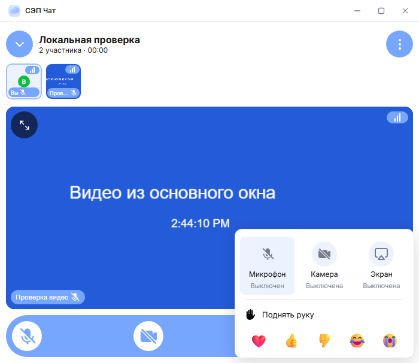

# Отдельное окно звонка Tauri

Ветка задачи: `chat-562`, целевая ветка PR — `main`. Релиз, деплой и merge не выполняются.

## Поведение

- В новой нативной сборке звонок открывается в окне `call` с собственной шапкой, сворачиванием, разворачиванием и системным полноэкранным режимом.
- В шапке нет отдельной кнопки fullscreen. «Видео fullscreen» внутри видео включает системный полноэкранный режим и убирает шапку. Кнопка возврата и Escape восстанавливают обычное окно; исчезновение видео также завершает его полноэкранный просмотр.
- Начальный размер берётся из существующих стилей веб-модалки. На широком экране область звонка — 700×570, сверху добавляется шапка 36 пикселей. Принятие входящего вызова не меняет размер. Ручное изменение размера, разворачивание и полноэкранное видео сохраняются.
- Escape сначала закрывает настройки/просмотр видео, затем выходит из fullscreen, затем скрывает окно, сохраняя звонок.
- Закрытие основного окна оставляет звонок работающим. Закрытие окна звонка вызывает существующее завершение/отклонение вызова один раз.
- «Перейти в чат» открывает топик в основном окне и переводит на него фокус, сохраняя видимость и содержимое окна звонка. Хедер активного звонка возвращает фокус в существующее окно, включая повторный клик при уже открытом звонке.
- Правый клик в окне звонка открывает меню с текущим состоянием и переключением микрофона, камеры и демонстрации, поднятием руки и реакциями.
- Микрофон, камера и экран переключаются сразу из меню: в окне звонка это три иконки с текущим состоянием, в трее — три пункта с цветными иконками. Панели статуса разрешений нет. Без активного звонка и во время переключения устройства кнопки отключены. Выключение из трея сохраняет фокус; включение с запросом доступа или выбором экрана открывает окно звонка.
- Демонстрация запрашивает согласие тем же диалогом, что камера и микрофон, включая повторную попытку после запрета. Системный доступ macOS запрашивается отдельно; отказ, остановка вызова и отмена выбора не запускают захват.
- О поднятых руках и новых реакциях других участников приходят нативные уведомления, когда окно звонка не в фокусе, скрыто или свёрнуто. Активность основного чата не подавляет эти события. Собственные, истёкшие и повторные события отбрасываются; клик по уведомлению возвращает только в текущую комнату.
- Браузер и Android продолжают использовать встроенную модалку. Старый Tauri без нового обработчика окон также сохраняет встроенную модалку.

## Состояние и медиа

Главное окно владеет единственным RTC-контроллером, сокетом и захватом устройств. Нативный обработчик разрешает только собственный `about:blank#sep-chat-call` и сохраняет связь с opener. Второй Vue DOM-renderer выводит те же компоненты в дочерний документ, сохраняя реактивные ссылки и контекст приложения. Настройки и диалоги разрешений переносятся в документ звонка; новые экземпляры глобальных диалогов не создаются.

Состояние окон запрашивается одним вызовом с меткой `main` или `call`. На Windows используются `GetForegroundWindow`, `IsIconic` и `IsWindowVisible`: фокус WebView/Tauri может расходиться с реальным активным окном. События фокуса и размера содержат метку; окно звонка не меняет кеш видимости главного чата. Перед подавлением уведомления о новом сообщении проверяется свежий снимок главного окна, включая последний выбранный топик. Ошибка IPC снимает активность вместо сохранения устаревшего положительного состояния.

Полноэкранным режимом звонка управляет один контроллер с последовательными переходами. Запоздалые ответы изменения размера и шапки не закрывают новый просмотр при быстром выходе и повторном входе в видео.

Зелёная волна микрофона в этом окне использует локальный анализ существующего аудиотрека: FFT 256, без усреднения, с немедленным нарастанием. AudioContext подготавливается при открытии звонка и остаётся готовым во время mute. События громкости LiveKit продолжают использоваться остальными клиентами. Освобождение анализатора не останавливает RTC-трек.

Стили и тема копируются из основного документа; в production перед показом ожидается загрузка CSS. Навигация дочернего окна на внешний сайт запрещена. Приложение в дочернем документе повторно не загружается, браузерное контекстное меню отключено.

## Локальная проверка

`bun scripts/preview-desktop-call-window.ts` запускает отдельный профиль `ru.pksep.chat.callpreview`, Vite на `127.0.0.1:5183` и локальный приём результатов на `127.0.0.1:5213`. Установленная версия, её сессия и протокол `sepchat` не заменяются. Проверка не звонит реальным пользователям. Служебные консоли скрыты; окна приложения остаются открытыми для проверки пользователем.

Фикстуры регрессионной проверки: `e2e/fixtures/desktop-call-window.html`, `e2e/fixtures/desktop-call-window.ts`, `e2e/fixtures/desktop-message-visibility.ts`. Профиль и отчёт: `test-results-native/call-window-preview`; профиль может использоваться полным локальным приложением и содержит его сессию. После проверки остановить принадлежащий запуску launcher, не затрагивая установленный чат.

Автоматическая проверка поверхности: `bun run test:e2e e2e/desktop-call-window.spec.ts --project=chromium-desktop`. Нативная проверка отдельно проверяет реальные состояния окон, передачу видео между документами, индикатор при скрытом чате, отсутствие повторного захвата и сохранность исходного аудиотрека после освобождения анализатора.

macOS WKWebView и Linux WebKitGTK требуют отдельной нативной проверки перед выпуском; Windows WebView2 не подтверждает их поведение.

Уведомления об активности используют короткий Windows toast tag (хеш комнаты, участника и типа события). Склейка UUID давала 100 символов и отклонялась `ToastNotification.Tag`. Регрессионная проверка использует UUID длиной 36 символов; `preview-desktop-call-window.ts --native-toasts` проверяет реальную доставку вместо подмены. При локальной проверке 24.11 оба события найдены через `ToastNotificationManager.History.GetHistory('ru.pksep.chat.callpreview')`, их теги — 15 символов или меньше.

Режим `--native-toasts` пропускает сообщение через настоящий обработчик входящих событий ChatSDK в выбранный топик, сворачивает главное окно и проверяет видимость после восстановления. В Windows дополнительно сохраняется `windows-message-history.json`: запись из системного Центра уведомлений, снятая до очистки при возврате в чат. Поднятая рука и реакция проверяются при активном главном чате, свёрнутом звонке и обоих свёрнутых окнах; собственные и повторные события не уведомляют.

Меню устройств: 
